# EGX Financial Performance Dashboard (Power BI)

An interactive Power BI report that lets an executive read the financial health of any company listed on the
Egyptian Exchange (EGX) in a few seconds: growth, profitability, cash, funding, liquidity, working capital and
peer comparison, all on six focused pages.

> Built during **EraaSoft – Session 04** as part of my data analyst portfolio.
> Default company in the report: **Juhayna (JUFO)**.

## Design target

The report was built from a written design brief (layout, colours, wording, one question per page).

| Page | Question it answers | Design target |
|---|---|---|
| 1. Overview | How is the company performing financially? | 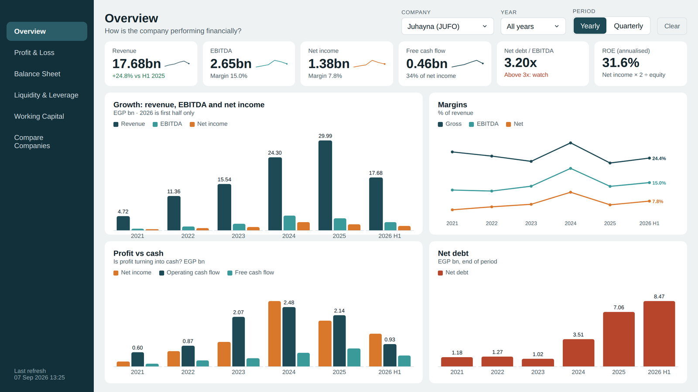 |
| 2. Profit & Loss | Is the company growing profitably? | 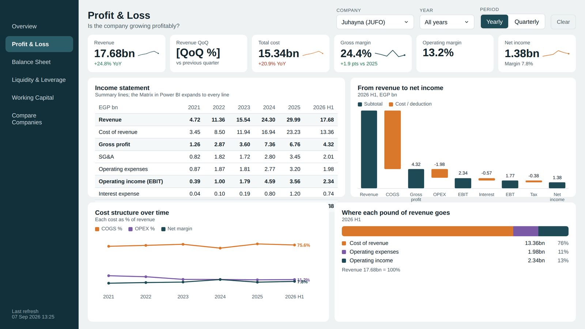 |
| 3. Balance Sheet | What does the company own, and how is it funded? | 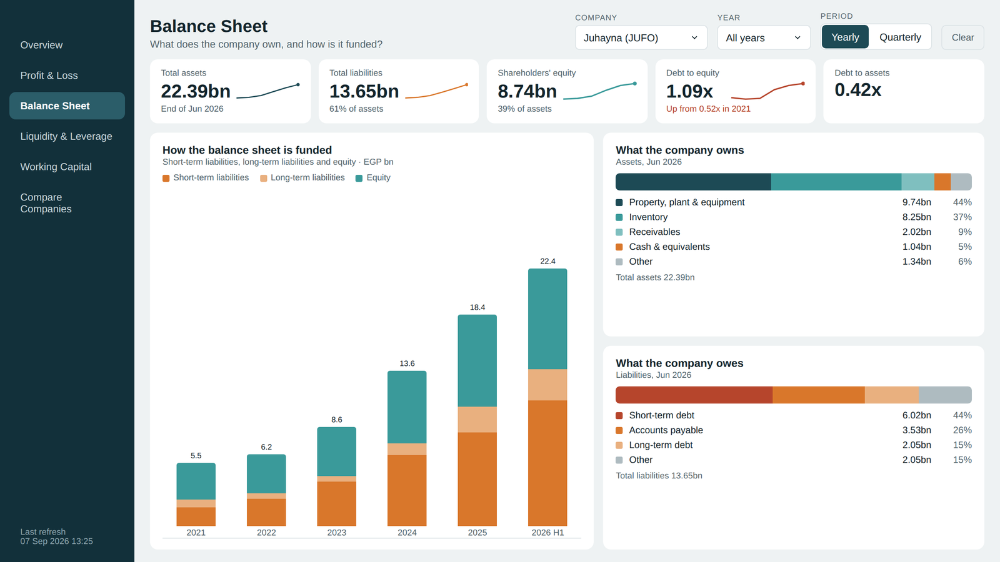 |
| 4. Liquidity & Leverage | Can the company meet its obligations? | 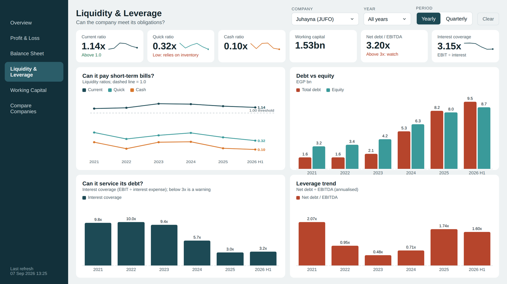 |
| 5. Working Capital | How efficiently does the company use its operating assets? | 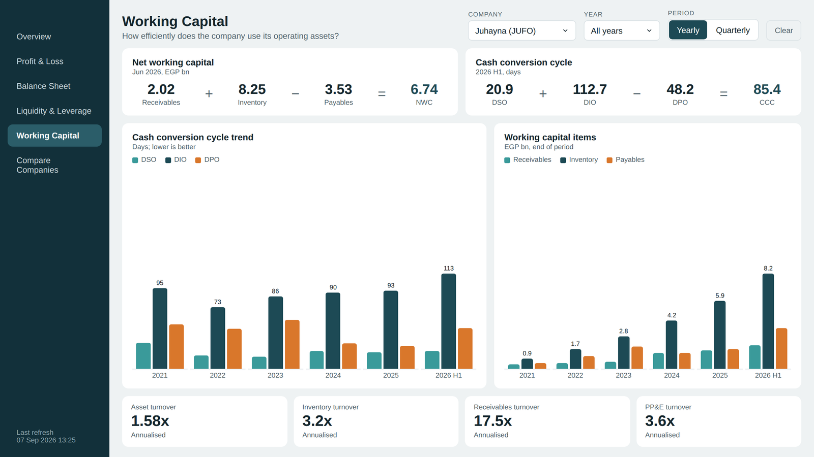 |
| 6. Compare Companies | How does the company stack up against its peers? | 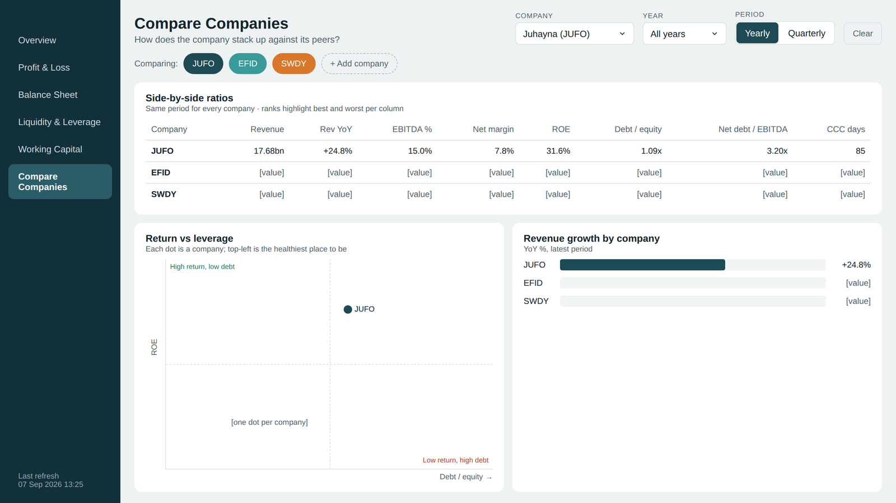 |

## The report

| Overview | Profit & Loss |
|---|---|
| 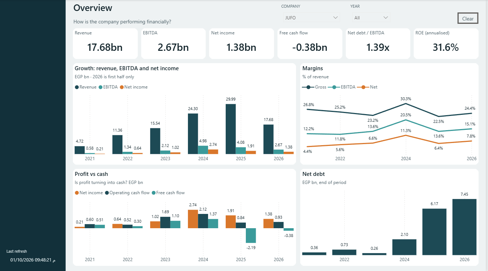 | 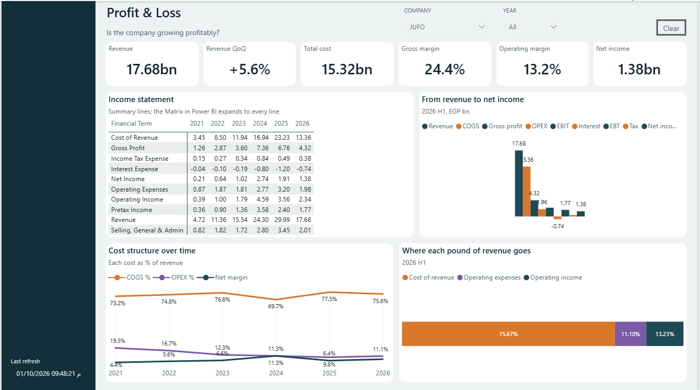 |
| **Balance Sheet** | **Liquidity & Leverage** |
| 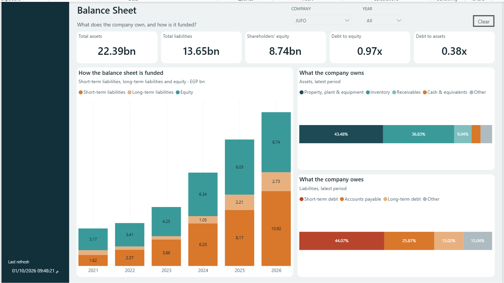 | 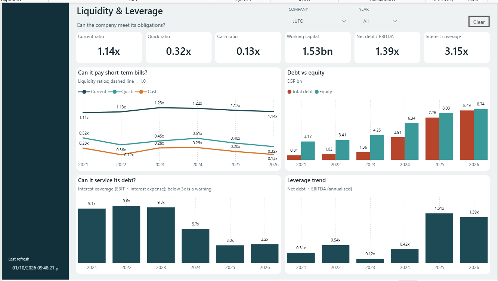 |
| **Working Capital** | **Compare Companies** |
| 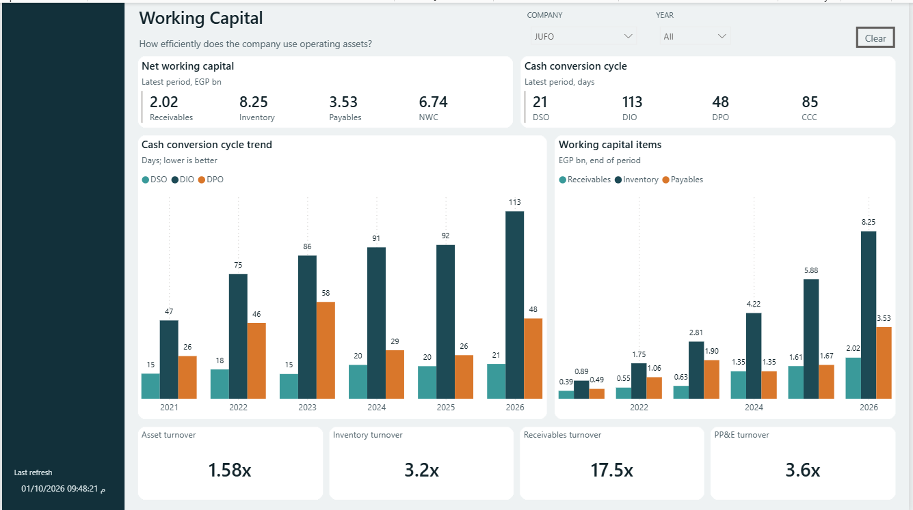 | 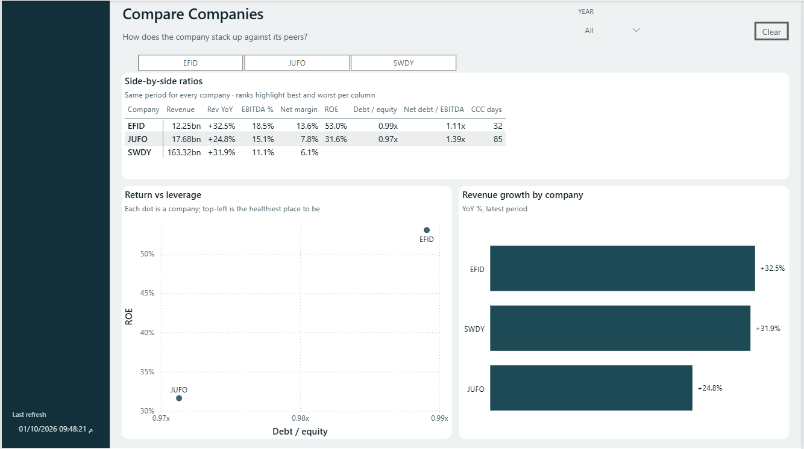 |

## Data

| | |
|---|---|
| File | `data/financials.xlsx` (sheet `Sheet1`) |
| Grain | one row per company, financial term and quarter |
| Size | 215,925 rows, 196 companies, 187 distinct financial terms |
| Period | Q4 2015 to Q2 2026 (quarter-end dates 2015-12-31 to 2026-06-30) |
| Columns | `Company`, `Financial Term`, `Statement Type`, `End Of Quarter`, `Amount` |
| Statements | income statement, balance sheet, cash flow |
| Unit | amounts are in EGP millions; the report divides by 1,000 to show EGP bn |

## Data model

Star schema, all relationships many-to-one, single direction:

```
DimDate (End of Quarter) ──┐
DimAccounts (Helper) ──────┼──< FactFinancials
DimStatements (Statement Type) ──┘
```

Plus a `Last Refreash` table (shown in the sidebar) and a `Measures List` table that holds all DAX measures
(77 in the model, grouped in display folders such as Base, BS and CashFlow).

## What is in the report

- **Six pages** with a left navigation bar, company and year filters (synced across pages) and a Clear button.
- **KPI cards** read the latest period in the current filter, so "All years" shows the most recent year/half-year,
  not a sum of every year.
- **Annualised ratios**: ROE, net debt / EBITDA and the four turnover ratios scale the period to 365 days, so a
  half-year is comparable with a full year.
- **Report-level measures** (stored in the report, not the model) fix and extend the model:
  - balance-sheet items read the **latest quarter that actually has data**. The date table contains empty future
    quarters, which made the model's `Snapshot Value` return blank for 2026;
  - the model's `PP&E` measure searches for a term that does not exist in the data
    (`Property, Plant & Equipment`), so a corrected version is used;
  - values shown in billions are divided by 1,000 inside the measure so they format cleanly (`17.68bn`).
- **Gaps in the source data are left blank, not guessed.** Some companies do not report every line: for example
  SWDY has no debt, liabilities, equity or payables lines, so its ROE, debt-to-equity, net debt / EBITDA and
  cash conversion cycle show as blank. EFID has no equity line, so its equity is derived as total assets minus
  total liabilities.
- **Custom theme** `design/EGX_Financials_theme.json` and page backgrounds in `design/backgrounds/`; every visual is
  placed from the coordinates in `design/layout_positions.json`.

## Colour system

| Use | Colour |
|---|---|
| Primary (revenue, assets) | `#1D4A55` |
| Secondary (EBITDA, equity) | `#3A9A9A` |
| Accent (net income, costs) | `#D9772B` |
| Purple (operating expenses) | `#7A5AA6` |
| Debt / warning | `#B6452C` |
| Good | `#2E7D5B` |
| Neutral / other | `#AEBBC0` |

Fonts: Segoe UI and Segoe UI Semibold.

## How to open

1. Install the latest **Power BI Desktop** (the file was saved with the September 2026 release in the enhanced
   report format).
2. Open `Stock_Analysis.pbix`.
3. The report points to the Excel file by an absolute path from my machine. Re-point it to `data/financials.xlsx`:
   *Home → Transform data → Data source settings → Change Source*, then **Apply changes**.
4. Pick a company in the **Company** filter (default JUFO).

## Known limitations

- The **Yearly / Quarterly** toggle from the brief is not built yet. It needs a field parameter in the model.
- The **waterfall** (revenue to net income) is shown as a column chart, because a real waterfall needs a small
  helper table with the step order.
- Income statement lines are sorted alphabetically (the model has no sort column on `DimAccounts`), and the
  x-axis shows `2026` instead of `2026 H1`.
- KPI sparklines and the small context lines under the cards ("+24.8% vs H1 2025") are not included.
- Some figures differ from the design target because the target was drawn with illustrative numbers; the report
  uses the model's own definitions (for example free cash flow = operating cash flow + capital expenditures).

## Repository layout

```
Session 04/
├── Stock_Analysis.pbix            the report
├── data/financials.xlsx           source data
├── screenshots/                   screenshots of the six report pages
├── design/
│   ├── Financial_Dashboard___Design_Brief.pptx
│   ├── EGX_Financials_theme.json
│   ├── layout_positions.json
│   ├── backgrounds/               page background images used in the report
│   └── mockups/                   design target for each page
└── README.md
```

## Tools

Power BI Desktop, DAX, Power Query, Excel.

## Author

**Beshoy Magdy Abdelsaid**: Computer Science student, Faculty of Computer Science and Artificial Intelligence,
Helwan University.
